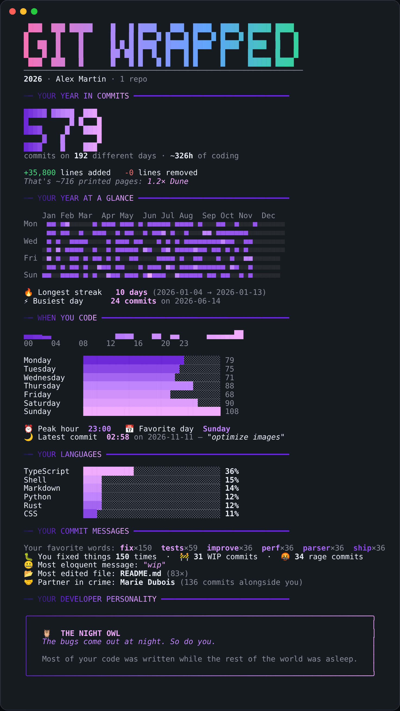

<div align="center">

# 🎁 git-wrapped

### Spotify Wrapped, but for your Git history.

**One command. Your whole coding year, turned into a stunning terminal recap<br>and an animated story you can share.**

```bash
npx git-wrapped
```


&nbsp;&nbsp;


Zero dependencies · Runs 100% locally · Nothing leaves your machine

</div>

---

## ✨ What you get

**1. A gorgeous terminal recap**: gradient titles, animated counters, a contribution heatmap, your coding clock…



**2. An animated story in your browser**: full-screen slides, Instagram-story style, with confetti 🎉

**3. A 1080×1350 share card**: download the PNG at the end and post it with **#GitWrapped**

## 🔮 Your developer personality

Based on *when* and *how* you commit, git-wrapped tells you who you really are:

| | Personality | You… |
|---|---|---|
| 🦉 | **The Night Owl** | commit while the world sleeps |
| 🌅 | **The Early Bird** | ship before the coffee is ready |
| ⚔️ | **The Weekend Warrior** | don't know what Saturday is |
| 🚒 | **The Firefighter** | are the one everybody calls when it's on fire |
| 🏃 | **The Marathoner** | kept a streak going for weeks |
| 🧹 | **The Cleaner** | deleted more code than you wrote |
| 🏗️ | **The Architect** | land whole features in one commit |
| 🎯 | **The Sniper** | make tiny, surgical commits |
| 🌪️ | **The Tornado** | had a day with 25+ commits |
| 💼 | **The Professional** | have achieved work-life balance |
| 🧑‍💻 | **The Steady Builder** | just kept building |

Which one are you? Run it and find out 👀

## 📊 Stats included

- Total commits, active days and **estimated hours of coding**
- Lines added/removed, plus **how many novels that would fill** (*"That's 1.2× Dune"*)
- Year heatmap, **longest streak** and busiest day
- Peak hour, favorite weekday and **your latest-night commit** 🌙
- Top languages
- Your favorite commit words, how many times you wrote "fix", **WIP and rage commits** 🤬
- Your most edited file and your **partner in crime**

## 🚀 Usage

```bash
# Wrap the current repository (your commits only)
npx git-wrapped

# Wrap ALL your projects at once 🤯
npx git-wrapped --scan ~/code

# A team recap of the current repo
npx git-wrapped --everyone

# Another year
npx git-wrapped --year 2025
```

| Option | Description |
|---|---|
| `-y, --year <year>` | Year to wrap (default: current year) |
| `-s, --scan <dir>` | Scan every git repo inside a folder |
| `-a, --author <who>` | Name or email to match (repeatable). Default: your `git config` |
| `--everyone` | Count all authors (team recap) |
| `--no-open` | Don't open the browser story |
| `--no-anim` | Disable terminal animations |
| `-o, --out <file>` | Where to save the HTML story |
| `--json` | Output raw stats as JSON (build your own thing!) |

## 🔒 Privacy

git-wrapped only reads your local `git log`. No network calls, no tracking, no account.
The story is a single HTML file saved on your machine.

## 🤝 Contributing

New personalities, stats or slides are very welcome! See [CONTRIBUTING.md](CONTRIBUTING.md).

If git-wrapped made you smile, **leave a ⭐**. It really helps!

## License

MIT
