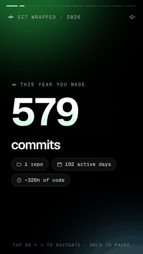

<div align="center">

# Git Wrapped

[](https://www.npmjs.com/package/dev-wrapped)
[](https://www.npmjs.com/package/dev-wrapped)
[](package.json)
[](LICENSE)

### Spotify Wrapped, but for your Git history.

**One command. Your whole coding year, turned into a stunning terminal recap<br>and an animated story you can share.**

```bash
npx dev-wrapped
```


&nbsp;&nbsp;


Zero dependencies · Works on one repo, all your repos, or a whole GitHub account

</div>

---

## Start here

Pick the line that matches what you have. New to all this? Follow the **[beginner tutorial](docs/GETTING_STARTED.md)**.

| You have… | Do this | Time |
|---|---|---|
| **Just a GitHub account** | [Put the card on your GitHub profile](docs/PROFILE_SETUP.md#option-b-do-it-by-hand), nothing to install | 3 min |
| **Node.js 18+** and a project with Git | Run `npx dev-wrapped` inside the project | 10 sec |
| **Claude Code** | Install the plugin and ask Claude to [set up your profile card](docs/PROFILE_SETUP.md#option-a-let-claude-code-do-it) | 2 min |

---

## What you get

**1. A gorgeous terminal recap**: gradient titles, animated counters, a contribution heatmap, your coding clock…


**2. An animated story in your browser**: full-screen slides, Instagram-story style, with confetti

**3. A 1080×1350 share card**: download the PNG at the end and post it with **#GitWrapped**

## Put it on your GitHub profile

Show an animated card on your profile that updates itself every day. It follows your visitors' light or dark theme.


### The 2-minute way: let Claude Code do it

In [Claude Code](https://claude.com/claude-code), with the [GitHub CLI](https://cli.github.com) logged in:

```
/plugin marketplace add Curtis-sama/dev-wrapped
/plugin install dev-wrapped@dev-wrapped
```

Then just ask: **"Put the dev-wrapped card on my GitHub profile"**. It creates your profile repository if needed, adds the workflow and the card, and runs it once.

### By hand

Full beginner-friendly guide: **[docs/PROFILE_SETUP.md](docs/PROFILE_SETUP.md)**. The short version:

**1.** In your profile repository (the one named like your username), create `.github/workflows/dev-wrapped.yml`:

```yaml
name: Git Wrapped
on:
  schedule:
    - cron: '0 6 * * *'   # every day at 06:00 UTC
  workflow_dispatch:       # lets you run it by hand
  push:                    # runs once as soon as you add this file
    paths: ['.github/workflows/dev-wrapped.yml']
permissions:
  contents: write
jobs:
  card:
    runs-on: ubuntu-latest
    steps:
      - uses: actions/checkout@v4
      - uses: Curtis-sama/dev-wrapped@v1
        with:
          timezone: Europe/Paris   # optional, for accurate coding hours
```

**2.** Add the card to your profile `README.md`:

```markdown

```

**3.** That's it: adding the workflow starts the first run. Your card shows up after about a minute.

> Put the image line **above** any `<!--` in your README: GitHub's default profile README hides its content inside an HTML comment.

| Input | Default | Description |
|---|---|---|
| `github_user` | repository owner | Account to wrap |
| `github_token` | `github.token` | Use a personal access token secret to include private contributions |
| `output` | `dev-wrapped.svg` | Where to write the card |
| `theme` | `auto` | `auto`, `dark` or `light` |
| `year` | current year | Year to wrap |
| `timezone` | `UTC` | Time zone for commit hours |
| `commit` | `true` | Commit the card to the repository |

You can also generate the card locally: `npx dev-wrapped --svg card.svg`.

## Your developer personality

Based on *when* and *how* you commit, git-wrapped tells you who you really are:

| Personality | You… |
|---|---|
| **The Night Owl** | commit while the world sleeps |
| **The Early Bird** | ship before the coffee is ready |
| **The Weekend Warrior** | don't know what Saturday is |
| **The Firefighter** | are the one everybody calls when it's on fire |
| **The Marathoner** | kept a streak going for weeks |
| **The Cleaner** | deleted more code than you wrote |
| **The Architect** | land whole features in one commit |
| **The Sniper** | make tiny, surgical commits |
| **The Tornado** | had a day with 25+ commits |
| **The Professional** | have achieved work-life balance |
| **The Steady Builder** | just kept building |

Which one are you? Run it and find out.

## Stats included

- Total commits, active days and **estimated hours of coding**
- Lines added/removed, plus **how many novels that would fill** (*"That's 1.2× Dune"*)
- Year heatmap, **longest streak** and busiest day
- Peak hour, favorite weekday and **your latest-night commit**
- Top languages
- Your favorite commit words, how many times you wrote "fix", **WIP and rage commits**
- Your most edited file and your **partner in crime**

## Usage

```bash
# Wrap the current repository (your commits only)
npx dev-wrapped

# Wrap ALL your projects at once
npx dev-wrapped --scan ~/code

# Your WHOLE GitHub account, nothing to clone
npx dev-wrapped --github

# Anyone's GitHub year
npx dev-wrapped --github torvalds

# A team recap of the current repo
npx dev-wrapped --everyone

# Another year
npx dev-wrapped --year 2025
```

| Option | Description |
|---|---|
| `-y, --year <year>` | Year to wrap (default: current year) |
| `-s, --scan <dir>` | Scan every git repo inside a folder |
| `-g, --github [user]` | Wrap a whole GitHub account (default: yours) |
| `--tz <zone>` | Time zone used for hours in GitHub mode (default: yours) |
| `-a, --author <who>` | Name or email to match (repeatable). Default: your `git config` |
| `--everyone` | Count all authors (team recap) |
| `--no-open` | Don't open the browser story |
| `--no-anim` | Disable terminal animations |
| `-o, --out <file>` | Where to save the HTML story |
| `--svg <file>` | Write the animated SVG card |
| `--theme <mode>` | SVG theme: `auto`, `dark` or `light` |
| `--json` | Output raw stats as JSON (build your own thing!) |

## GitHub mode

`--github` reads a whole account through the GitHub API: commits on every repo (including other people's projects you contributed to), **pull requests, reviews, issues** and your exact profile contribution calendar.

It needs a token, and finds one by itself if you use the [GitHub CLI](https://cli.github.com) (`gh auth login`). Otherwise:

```bash
GITHUB_TOKEN=<your token> npx dev-wrapped --github
```

Create the token at [github.com/settings/tokens](https://github.com/settings/tokens). No scope is needed for public data; add `repo` to include your private repositories.

> Commit details come from the default branch of the 40 repos you contributed to most.

## Privacy

In local mode, git-wrapped only reads your `git log`: no network calls, no tracking, no account.
In `--github` mode it talks only to `api.github.com`, with your own token.
The story is a single HTML file saved on your machine.

## Contributing

New personalities, stats or slides are very welcome! See [CONTRIBUTING.md](CONTRIBUTING.md).

If git-wrapped made you smile, **leave a star**. It really helps!

## Credits

- Typeface: [Geist and Geist Mono](https://vercel.com/font) by Vercel, under the SIL Open Font License (see `src/fonts/OFL.txt`).
- Icons: original line icons drawn for this project.

## License

MIT
