# Getting started with Git Wrapped

Never used a terminal? No problem. This guide starts from zero.

There are two things you can do with Git Wrapped:

- **A card on your GitHub profile** that updates itself every day. You only need a GitHub account. → [Path 1](#path-1-a-card-on-your-github-profile-nothing-to-install)
- **Your full year in review on your computer**: a terminal recap, an animated story in your browser and an image to share. You need to install Node.js once. → [Path 2](#path-2-your-year-in-review-on-your-computer)

---

## Path 1: a card on your GitHub profile (nothing to install)



Everything happens on github.com, in your browser. Follow **[the profile setup guide](PROFILE_SETUP.md#option-b-do-it-by-hand)**: it takes about 3 minutes.

---

## Path 2: your year in review on your computer

### Step 1: install Node.js

Node.js runs the tool. Install it once:

- **Windows**: download the **LTS** version from [nodejs.org](https://nodejs.org) and run the installer (keep the default options).
- **macOS**: download the **LTS** version from [nodejs.org](https://nodejs.org), or run `brew install node` if you use Homebrew.
- **Linux**: follow [the instructions for your distribution](https://nodejs.org/en/download/package-manager).

### Step 2: install Git

Git Wrapped reads your project history with Git.

- **Windows**: download it from [git-scm.com](https://git-scm.com/download/win) and run the installer (keep the default options).
- **macOS**: open Terminal and type `git --version`. If Git is missing, macOS offers to install it.
- **Linux**: install the `git` package, for example `sudo apt install git`.

### Step 3: open a terminal

- **Windows**: press the Windows key, type **PowerShell**, press Enter.
- **macOS**: press `Cmd + Space`, type **Terminal**, press Enter.
- **Linux**: open your Terminal app.

Check that everything is installed:

```bash
node -v
```

```bash
git --version
```

You should see a version number for each, like `v22.11.0` and `git version 2.47.0`. Node must be **18 or higher**.

> If you installed them while a terminal was already open, close it and open a new one first.

### Step 4: go to one of your projects

Type `cd`, a space, then the path of a project folder that uses Git:

```bash
cd Documents/my-project
```

> **Tip:** type `cd ` (with the space), then drag the folder from your file explorer into the terminal window. The path is filled in for you. Press Enter.

No project on your computer? Skip to [Wrap your whole GitHub account](#wrap-your-whole-github-account).

### Step 5: run it

```bash
npx dev-wrapped
```

The first time, npm asks `Need to install the following packages: dev-wrapped. Ok to proceed? (y)`. Type `y` and press Enter.

Then:

1. Your recap plays in the terminal: your commits, your year heatmap, your coding hours, your languages, and your **developer personality**.
2. Your browser opens an **animated story**. Tap or use the arrow keys to move through it.
3. On the last slide, click **Save image** to download your card, ready to share.

### Go further

#### Wrap all your projects at once

Point it at the folder that contains your projects:

```bash
npx dev-wrapped --scan ~/code
```

On Windows, use the real path, for example:

```bash
npx dev-wrapped --scan C:\Users\you\Documents\projects
```

#### Wrap your whole GitHub account

This reads all your activity on GitHub, including pull requests and reviews, without cloning anything. GitHub requires a token for it:

1. Create one at [github.com/settings/tokens/new](https://github.com/settings/tokens/new): give it a name, tick **repo** and **read:user**, click **Generate token** and copy it.
2. Run, replacing `ghp_yourtoken` with your token:

   **macOS / Linux**
   ```bash
   GITHUB_TOKEN=ghp_yourtoken npx dev-wrapped --github
   ```

   **Windows (PowerShell)**
   ```bash
   $env:GITHUB_TOKEN="ghp_yourtoken"; npx dev-wrapped --github
   ```

> If you use the [GitHub CLI](https://cli.github.com) and ran `gh auth login`, you don't need a token: just run `npx dev-wrapped --github`.

Keep your token private: never paste it in a file you share, an issue or a chat.

#### Other options

```bash
npx dev-wrapped --year 2025       # another year
npx dev-wrapped --everyone        # a team recap of the current project
npx dev-wrapped --help            # every option
```

---

## Troubleshooting

| Message | What to do |
|---|---|
| `npx is not recognized` / `command not found: npx` | Node.js is not installed, or the terminal was open during the install. Install Node.js (step 1), then open a **new** terminal. |
| `npx.ps1 cannot be loaded because running scripts is disabled` (Windows) | Use `npx.cmd dev-wrapped` instead of `npx dev-wrapped`. |
| `Not inside a git repository` | You are not in a project folder. Go to one with `cd` (step 4), or use `--scan` or `--github`. |
| `Found … commits in 2026, but none by …` | Your commits use another name or email. Add `--author "your name"`, or `--everyone` to count everybody. |
| `No commits found in 2026` | Nothing was committed this year in that project. Try `--year 2025`. |
| `GitHub mode needs a token` | See [Wrap your whole GitHub account](#wrap-your-whole-github-account). |
| The browser doesn't open | Open the `file://…` link printed at the end of the terminal output. |

Still stuck? [Open an issue](https://github.com/Curtis-sama/dev-wrapped/issues) and paste the message you got.
